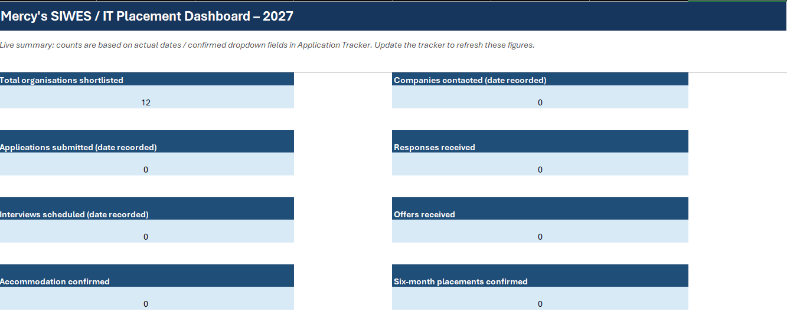

# SIWES & IT Placement Tracker 2027

**An Excel-based application tracking and decision-support tool for aspiring Data Analysts, Business Intelligence Analysts, Business Analysts, and Marketing Analysts.**

## Project Overview

Finding a relevant SIWES or IT placement is not just about securing an internship. It is about finding an organisation where you can gain practical experience, develop industry-relevant skills, and apply what you have learned.

I developed this project to organise and support my search for a six-month SIWES placement, with a specific focus on opportunities in Data Analytics, Business Intelligence, Business Analysis, and Marketing Analytics.

Rather than serving as a generic internship tracker, this workbook helps evaluate organisations based on their relevance to these career paths, monitor application progress, assess placement conditions, and make informed relocation decisions.

## Key Features

- **Industry-Focused Company Shortlist:** Identifies and evaluates organisations based on their relevance to analytics, business intelligence, business analysis, and marketing-related roles.
- **Application Tracking:** Monitors applications, responses, interviews, follow-ups, and placement progress.
- **Relocation Budget Analysis:** Evaluates estimated expenses, stipends, accommodation, and potential funding gaps.
- **Document Checklist:** Organises essential SIWES application documents.
- **Interactive Dashboard:** Provides an overview of application performance and placement readiness.

## Tools & Concepts

- Microsoft Excel
- Data Organisation and Management
- Excel Formulas
- Data Validation and Dropdowns
- Conditional Formatting
- Dashboard Design
- Business Intelligence and Decision Support

## Project Objective

To create a structured, data-driven approach to finding and evaluating SIWES opportunities that align with my academic background and career interests in Data Analytics and Business Intelligence.

## Project Status

Developed for my 2027 SIWES placement search and continuously refined as I research organisations and progress through the application process.

## Dashboard Preview

